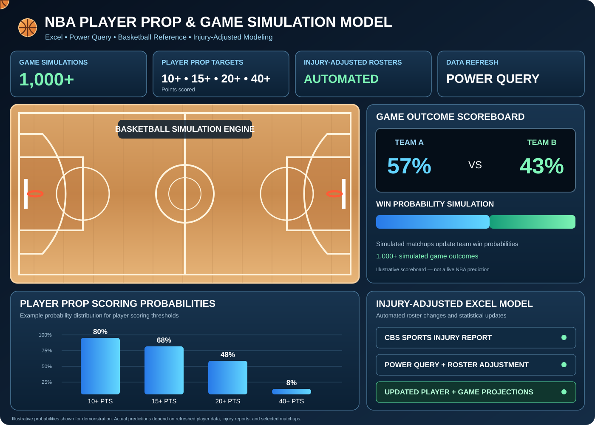

# 🏀 NBA Player Prop & Game Simulation Model
### Excel Automation | Power Query | Statistical Modeling | Sports Analytics

An Excel-based NBA analytics and simulation model that transforms real basketball statistics and injury reports into **player scoring probabilities, team projections, and simulated game outcomes**.

Built for **Microsoft Excel on Windows**, this project demonstrates automated data collection, statistical analysis, dynamic roster adjustments, and predictive modeling.

---

## 🏀 Interactive Basketball Analytics Dashboard

*Animated visualization of the model's basketball analytics workflow, scoring probability distributions, and game simulations. Example probabilities are illustrative.*

---

## 🎯 Project Overview

The goal of this project was to build an automated basketball analytics system using Excel rather than traditional programming languages.

By integrating external basketball statistics with injury reports, the model can:

- Analyze individual player scoring performance.
- Estimate player scoring probabilities across multiple point thresholds.
- Simulate NBA matchups to estimate team win probabilities.
- Automatically adjust team rotations based on reported player injuries.
- Refresh statistical inputs through Power Query.

**The result:** A dynamic Excel simulation environment that connects real-world basketball data with statistical modeling and game predictions.

---

## ⚡ Key Features

### 🩼 1. Automated Injury-Adjusted Simulations

One of the model's most important capabilities is its ability to incorporate player availability into game simulations.

The workbook integrates injury information from the [CBS Sports NBA Injury Report](https://www.cbssports.com/nba/injuries/).

**How it works:**

1. Retrieves updated player injury information.
2. Identifies injured players within the selected teams.
3. Excludes unavailable players from the active rotation.
4. Adjusts team scoring projections and player opportunities.
5. Recalculates simulated game outcomes.

This allows the model to account for roster changes rather than relying on static team statistics.

### 📊 2. Player Prop Probability Modeling

The workbook estimates the probability of individual players reaching specific scoring thresholds.

**Supported scoring targets:**

- 10+ points
- 15+ points
- 20+ points
- 25+ points
- 30+ points
- 35+ points
- 40+ points

These estimates help evaluate player scoring expectations using historical statistical performance and model calculations.

Color-coded Excel outputs make probability distributions easier to interpret.

### 🏆 3. NBA Game Outcome Simulations

The model performs **1,000+ game simulations** to estimate possible matchup outcomes.

It incorporates player-level statistical inputs and roster availability to generate:

- Simulated wins and losses
- Team win probabilities
- Team scoring projections
- Matchup comparisons

This provides a probability-based perspective on NBA games rather than relying solely on season records or individual averages.

### 🔄 4. Automated Data Collection with Power Query

The workbook uses Power Query to retrieve and transform basketball statistics from external sources.

**Data workflow:**

`Basketball Reference → Power Query → Excel Data Model → Player Projections → Game Simulations`

Key capabilities include:

- Importing NBA per-game player statistics
- Refreshing external data connections
- Switching between NBA seasons by updating the source URL
- Integrating player availability information
- Updating downstream calculations when source data changes

This demonstrates an automated data pipeline built entirely within Excel.

---

## 🧠 Technical Implementation

| Component | Implementation |
|---|---|
| Data collection | Power Query and web-based HTML tables |
| Data sources | Basketball Reference and CBS Sports |
| Data transformation | Power Query |
| Player identification | Excel lookup formulas |
| Statistical modeling | Advanced Excel formulas |
| Injury adjustments | Dynamic roster exclusion logic |
| Game simulations | 1,000+ simulated matchup outcomes |
| Visualization | Conditional formatting and probability displays |
| Platform | Microsoft Excel for Windows |

### Advanced Excel Functions

The model uses:

`XLOOKUP` · `INDEX` · `IFERROR` · `SMALL`

Along with dynamic named ranges, conditional formatting, and interconnected worksheet calculations.

These features support automated player identification, statistical calculations, and simulation updates.

---

## 💡 Real-World Applications

**Sports Analytics**

Evaluate player performance, team scoring expectations, and matchup probabilities using historical basketball statistics.

**Predictive Modeling**

Apply statistical calculations and repeated simulations to estimate possible outcomes.

**Data Analytics & Automation**

Demonstrate how Excel and Power Query can collect, transform, and analyze external datasets.

**Fantasy Basketball & Content Analysis**

Explore player scoring expectations and injury-adjusted projections for matchup research and game previews.

---

## ⚙️ How to Use the Model

1. Download the Excel workbook from this repository.
2. Open the workbook using **Microsoft Excel for Windows**.
3. Navigate to `Data → Refresh All` to update the external data connections.
4. Select the two NBA teams you want to simulate.
5. Allow the model to update its calculations.

The workbook then generates updated player statistics, injury-adjusted rotations, scoring probabilities, and simulated game outcomes.

**Note:** Internet access is required for external data refreshes. Availability of source data depends on the external websites and their table structures.

---

## 📁 Repository Files

| File | Description |
|---|---|
| `NBA_Player_Prop_Model.xlsx` | Excel-based player prop and game simulation workbook |
| `nba_basketball_court_animated.svg` | Animated basketball analytics dashboard |
| `nba-simulation-dashboard.jpeg` | Static dashboard preview |
| `README.md` | Project documentation |

---

## 📡 Data Sources

- 📊 [Basketball Reference — NBA Player Statistics](https://www.basketball-reference.com/leagues/NBA_2023_per_game.html)
- 🩼 [CBS Sports — NBA Injury Reports](https://www.cbssports.com/nba/injuries/)

---

## 🧰 Technologies & Skills Demonstrated

**Microsoft Excel** • **Power Query** • **Data Transformation** • **Web Data Extraction** • **Statistical Modeling** • **Predictive Analytics** • **Simulation Modeling** • **Data Visualization** • **Workflow Automation**

---

### 📌 Project Summary

Developed an automated NBA analytics model using **Excel and Power Query**, integrating real basketball statistics and injury reports to generate player scoring probabilities and simulate 1,000+ game outcomes.

The project demonstrates how advanced Excel automation, external data integration, and statistical modeling can transform raw sports data into actionable analytical insights.

*This project is intended for sports analytics, statistical modeling, and portfolio demonstration. Simulated outcomes are estimates, not guaranteed predictions.*
